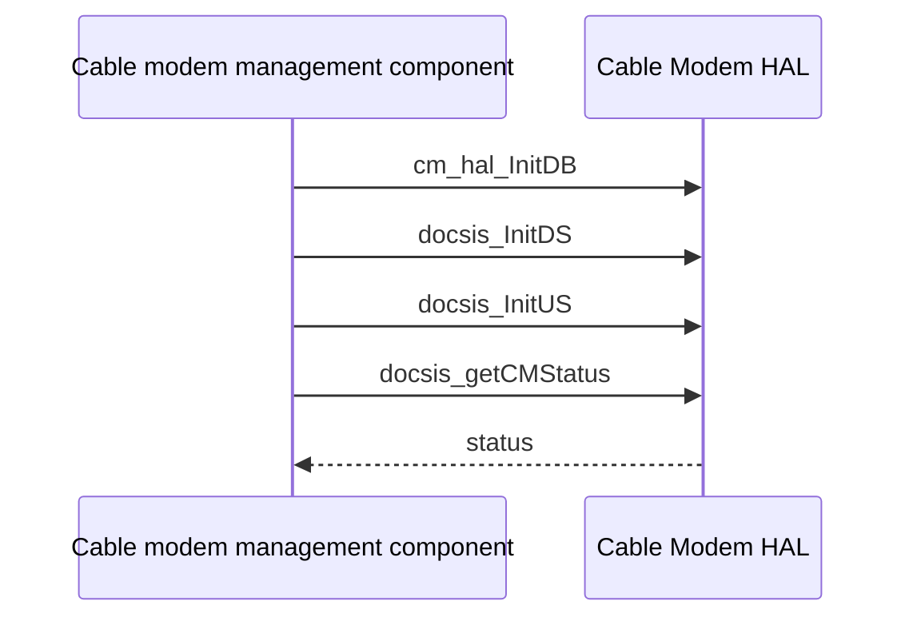

# Cable Modem HAL Specification

## Version History

| Date | Comment | Version |
| --- | --- | --- |
| — | Documentation alignment; no ABI change. | — |

## Acronyms
HAL means Hardware Abstraction Layer; CM means Cable Modem; DOCSIS means Data Over Cable Service Interface Specification; DS/US mean downstream/upstream.

## Description
The cable modem management component uses this HAL for initialization, channel and registration observations, diagnostics, firmware download, resets, and diplexer integration.

## Optional Components
OFDM/OFDMA, low-latency DOCSIS, and diplexer support depend on the implementation and enabled product features.

## Component Runtime Execution Requirements
### Initialization and Startup
Initialize the database with `cm_hal_InitDB`, then downstream with `docsis_InitDS` and upstream with `docsis_InitUS` before dependent observations.
### Threading Model
Serialize control operations unless the vendor guarantees concurrency.
### Process Model
Use the vendor library in process; coordinate other modem-management writers.
### Memory Model
Callers own supplied storage. Follow the linked header's table sizes, count parameters, allocation exceptions, and units.
### Power Management Requirements
Energy detection is exposed; it is not a general power-transition API.
### Asynchronous Notification Model
`cm_hal_Register_DiplexerVariationCallback` exposes notification. Keep callback state valid while notifications can occur.
### Internal Error Handling
Check each operation's documented result. Firmware update, MAC reinitialization, event-log clearing, and reset operations can disrupt service.
### Persistence Model
Use product-approved recovery procedures for firmware and provisioning changes.

## Nonfunctional Requirements
### Logging and Debugging
Implementations must not log credentials, secrets, security-sensitive information, or other sensitive data. Log operation outcomes rather than payloads.
### Quality Control
Use compiler warnings, static analysis, memory checks, and product-qualified destructive-test restoration.
### Licensing
See repository Apache-2.0 notices.
### Build Requirements
Compile against the public header and product implementation; legacy packaging names `libcm_mgnt.so`.
### Variability Management
Test only supported channel types and feature branches.

## Interface API Documentation
Exact signatures, field-level units/bounds, and returns are provided beside each declaration in the linked header.

| Area | Operations |
| --- | --- |
| Initialization | `cm_hal_InitDB`, `docsis_InitDS`, `docsis_InitUS` |
| Status/channels | `docsis_getCMStatus`, `docsis_GetDSChannel`, `docsis_GetUsStatus`, `docsis_GetUSChannel`, `docsis_GetDOCSISInfo`, `docsis_GetNumOfActiveTxChannels`, `docsis_GetNumOfActiveRxChannels`, `docsis_GetErrorCodewords` |
| Channel configuration | `docsis_GetMddIpModeOverride`, `docsis_SetMddIpModeOverride`, `docsis_GetUSChannelId`, `docsis_SetUSChannelId`, `docsis_GetDownFreq`, `docsis_SetStartFreq` |
| Event logs | `docsis_GetDocsisEventLogItems`, `docsis_ClearDocsisEventLog` |
| Network/product | `cm_hal_GetDHCPInfo`, `cm_hal_GetIPv6DHCPInfo`, `cm_hal_GetCPEList`, `cm_hal_GetMarket`, `docsis_GetProvIpType` |
| Download configuration | `cm_hal_Set_HTTP_Download_Url`, `cm_hal_Get_HTTP_Download_Url`, `cm_hal_Set_HTTP_Download_Interface`, `cm_hal_Get_HTTP_Download_Interface` |
| Download/reset | `cm_hal_HTTP_Download`, `cm_hal_Get_HTTP_Download_Status`, `cm_hal_Reboot_Ready`, `cm_hal_HTTP_Download_Reboot_Now`, `cm_hal_FWupdateAndFactoryReset`, `cm_hal_ReinitMac`, `cm_hal_HTTP_LED_Flash` |
| Certificates | `docsis_GetCert`, `docsis_GetCertStatus` |
| Reset counts | `cm_hal_Get_CableModemResetCount`, `cm_hal_Get_LocalResetCount`, `cm_hal_Get_DocsisResetCount`, `cm_hal_Get_ErouterResetCount` |
| Advanced channels | `docsis_GetDsOfdmChanTable`, `docsis_GetUsOfdmaChanTable`, `docsis_GetStatusOfdmaUsTable`, `docsis_LLDgetEnableStatus` |
| Platform integration | `cm_hal_snmpv3_kickstart_initialize`, `docsis_IsEnergyDetected`, `cm_hal_set_ReinitMacThreshold`, `cm_hal_get_ReinitMacThreshold`, `cm_hal_get_DiplexerSettings`, `cm_hal_Register_DiplexerVariationCallback` |

### Theory of Operation and Key Concepts
Channel information, provisioning state, firmware-download status, and energy detection are distinct observables. A successful download initiation does not establish completed flashing or reboot readiness.

### Sequence Diagram

## Source References
- [cm_hal.h](https://github.com/rdkcentral/rdkb-halif-cm/blob/develop/include/cm_hal.h)
